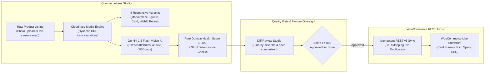

<div align="center">

# CommerceLens

### Visual Catalog Intelligence & Quality Gate for WooCommerce

**Audit listing health, transform photography via Cloudinary URL engines, and enrich with multimodal Vision AI — before publishing to your storefront.**

[](https://nextjs.org/)
[](https://tailwindcss.com/)
[](https://cloudinary.com/)
[](https://deepmind.google/technologies/gemini/)
[](https://woocommerce.com/)
[](LICENSE)

[**Live Application**](http://localhost:3000) · [**Explore Catalog**](http://localhost:3000/products) · [**Video Scripts (Planning & Result)**](VIDEO_SCRIPT.md) · [**GitHub Repo**](https://github.com/salim7-s/-CommerceLens) · [**Architecture Docs**](#architecture--design-patterns)

---

</div>

## The Problem

Most e-commerce merchants publish products with incomplete descriptions, missing SEO tags, uncompressed images with irregular aspect ratios, and unverified attributes. In WooCommerce, this leads to rejected marketplace syndications, poor search visibility, slow storefront loading, and high cart abandonment.

**CommerceLens bridges that gap.**

Audit every product against a **deterministic 7-point Health Score**, generate **6 responsive Cloudinary image variants** on the fly, extract missing attributes with **Google Gemini Multimodal Vision AI**, and enforce an **approval gate (score ≥ 80)** before any listing can be syndicated to WooCommerce.



---

## Key Capabilities

### 1. Deterministic 7-Point Product Health Score
Every catalog item is mathematically audited against seven deterministic rules:
- **Title Length**: 15 to 70 characters (flags single-word titles like "shoe").
- **Rich Description**: Minimum 120 characters of factual commercial copy.
- **Product Photography**: High-resolution image presence.
- **Accessibility Alt-Text**: Screen-reader compliant image description.
- **Price Validity**: Positive numeric pricing with currency standard.
- **Category Classification**: Assigned to a valid product category.
- **Mandatory Attributes**: Verified against category-driven template specifications (e.g. Size, Color, Material).

### 2. Cloudinary Dynamic Media Engine & Live Camera Snap
- **Zero Extra Storage Cost**: Generates responsive variants on the fly via URL transformations (`f_auto,q_auto`, `c_pad,w_1000,h_1000,b_white`, `c_fill,w_200,h_200,g_auto`).
- **6 Active Transformation Profiles**: Original baseline, Optimized Web Delivery, 1:1 Product Card Frame, Marketplace Square (Amazon/Google Shopping compliant), Thumbnail, and WebP format.
- **Device Camera Capture**: Merchants can click photos directly using their phone or laptop camera (`getUserMedia`), with real-time viewfinder and direct Cloudinary upload stream.

### 3. Multimodal Vision AI Intelligence (Google Gemini 1.5 Flash)
- **Visual Spec Extraction**: Analyzes photography flats to infer color, material, gender, and technical attributes.
- **Zero Hallucination Guardrail**: Refrains from guessing missing specs—flags them under `missingAttributes` for merchant verification.
- **SEO & Alt-Text Copywriting**: Synthesizes 3–8 search hashtags, high-converting descriptions, and accessible alt-text.

### 4. Amazon & Flipkart Style Product Showcase
- **High-Visibility Cards Grid**: Real commercial products (Nike Air Max sneakers, Patagonia daypack, Sony WH-1000XM5 headphones, Vans Old Skool) with clean white-frame photography, bold price tags, category tags, and health score pills.
- **Interactive View Switcher**: Instant toggle between Amazon/Flipkart Card Grid View and Compact Table View.

### 5. Autonomous Catalog Quality Agent (`/agent`)
- **Executive Policy Runner**: Scans catalog, identifies low-scoring items, synthesizes Cloudinary variants, and formulates listing proposals.
- **Safety Guardrails**: Defaults to safe **Dry-Run Mode** with a strict **25-step execution cap**.
- **Human-Centric Timeline**: Presents actions as readable activity cards (not raw JSON dumps), with an optional collapsible technical payload toggle for developers.

### 6. Idempotent WooCommerce Syndication (`/sync-log`)
- Uses official WooCommerce REST API v3 (`@woocommerce/woocommerce-rest-api`).
- Ensures idempotency via SKU mapping to prevent duplicate listings.
- Complete audit trail with timestamps, request hashes, and error feedback.

---

## Architecture & Design Patterns

CommerceLens implements a strict **Hexagonal Architecture (Ports & Adapters)** to decouple business logic from external infrastructure:

```text
src/
├── domain/                    <-- Pure business logic (Zero I/O, 100% testable)
│   ├── health.ts              <-- computeHealth(): deterministic 7-point scoring
│   ├── attributes.ts          <-- validateAttributes(): category template validation
│   ├── mapping.ts             <-- toWooProduct(): PIM to WooCommerce REST mapping
│   └── schemas.ts             <-- Zod schemas for Product, Category, and AI payloads
│
├── ports/                     <-- Core interface contracts
│   ├── ProductRepoPort.ts     <-- Product CRUD persistence contract
│   ├── CategoryRepoPort.ts    <-- Category & template persistence contract
│   ├── MediaPort.ts           <-- Image upload & URL transformation contract
│   ├── AIPort.ts              <-- Multimodal suggestion & enrichment contract
│   ├── StorePort.ts           <-- WooCommerce synchronization contract
│   └── AgentRepoPort.ts       <-- Autonomous agent trace persistence contract
│
├── adapters/                  <-- Infrastructure implementations
│   ├── repo/sqlite/           <-- SQLite adapter (better-sqlite3, globalThis singleton)
│   ├── media/cloudinary.ts    <-- Cloudinary adapter (Dynamic URL engine & stream upload)
│   ├── ai/gemini.ts           <-- Google Gemini 1.5 Flash multimodal vision adapter
│   ├── ai/mock.ts             <-- Resilient offline fallback adapter
│   └── store/woocommerce.ts   <-- WooCommerce REST v3 client adapter
│
├── services/                  <-- Application orchestrators & dependency injection
│   ├── ProductService.ts      <-- Listing lifecycle & health recalculation
│   ├── SyncService.ts         <-- Quality gate enforcement & idempotent sync
│   ├── AgentService.ts        <-- Autonomous policy runner
│   └── container.ts           <-- Dependency injection container
│
└── app/                       <-- Next.js 16 App Router (Warm Linen & Stone Palette)
    ├── page.tsx               <-- Executive overview & Amazon/Flipkart product showcase
    ├── products/              <-- Catalog table & card grid with search & filters
    ├── products/[id]/improve/ <-- Inspection studio (Checklist, Cloudinary & AI diff)
    ├── products/new/          <-- Product creator with live camera snapshots
    ├── agent/                 <-- Autonomous Quality Agent console & activity trace
    └── sync-log/              <-- WooCommerce REST v3 audit logs
```

---

## Quickstart & Local Setup

### Prerequisites
- Node.js v18+ or v20+
- npm or pnpm

### 1. Installation
```bash
# Navigate to the CommerceLens application folder
cd CommerceLens

# Install dependencies
npm install
```

### 2. Environment Configuration
Create a `.env.local` file in `CommerceLens/`:

```env
# Cloudinary Credentials
CLOUDINARY_CLOUD_NAME=your_cloud_name
CLOUDINARY_API_KEY=your_cloudinary_api_key
CLOUDINARY_API_SECRET=your_cloudinary_api_secret

# WooCommerce Store Settings (LocalWP, Docker, or Live Store)
WOO_URL=http://localhost:8080
WOO_KEY=ck_your_woocommerce_key
WOO_SECRET=cs_your_woocommerce_secret

# AI Provider Settings ('gemini' | 'mock')
AI_PROVIDER=gemini
AI_API_KEY=your_gemini_api_key_here

# Sync Mode ('mock' | 'real')
SYNC_MODE=mock
```

### 3. Initialize & Seed Database
```bash
npm run seed
```

### 4. Start Development Server
```bash
npm run dev
```
Open **`http://localhost:3000`** in your browser.

---

## Running Tests & Verification

```bash
# Run unit & domain health tests (21 tests)
npm run test

# Run ESLint validation
npm run lint

# Verify system health endpoint
curl http://localhost:3000/api/health
```

---

## License

Distributed under the MIT License. Built for the Kilowott Hack-AI-thon.
